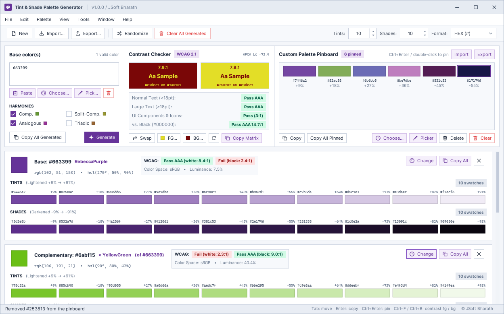
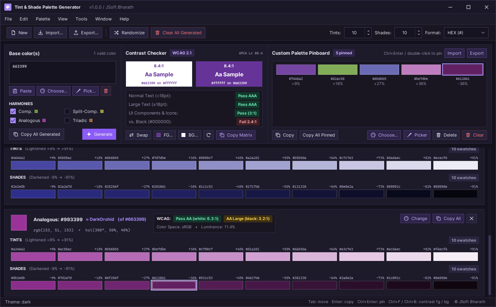

# Tint & Shade Palette Generator

A desktop tool to generate **tints, shades and colour harmonies** from any base colour, check **WCAG 2.1 / APCA contrast**, and collect favourite colours on a **pinboard**. Fully keyboard driven, with a custom title bar and a **theme file you can edit while the app is running**.

---
#### Note : Vibe Coded, In-Development - Bugs may exist - Use with caution - Report Bugs and Feature Requirements!!!
    

## ❤️ Support This Project

If you enjoy using this software, you can support
its continued development!

### 🍕 Buy Me a Pizza  
<a href="https://buymeacoffee.com/sahasrarachakra?l=en">
  
</a>


## If you are an Indian Supporter
### 🇮🇳 Support via UPI

Scan this QR code using Google Pay, PhonePe or Paytm.


Thank you for supporting open-source development!

---

### Screens
<details>
<summary>Light theme</summary>
</details>



<details>
<summary>Dark theme</summary>
</details>



© JSoft Bharath. All rights reserved.

----

## Table of contents

1. [Prerequisites](#prerequisites)
2. [Run](#run)
3. [How to use](#how-to-use)
4. [Keyboard shortcuts](#keyboard-shortcuts)
5. [Theming](#theming)
6. [Fonts](#fonts)
7. [Build from source](#build-from-source)
8. [Project layout](#project-layout)

---

## Prerequisites

### To run (normal users)

* **Java 21 or newer** (a JRE or a JDK – either works). Check with `java -version`.
  Free builds: [Adoptium Temurin](https://adoptium.net), Oracle JDK, Microsoft OpenJDK, etc.
* Windows, macOS or Linux with a desktop. Nothing else to install – no database, no extra libraries.
* The **Inter** font is bundled inside the jar. **Cascadia Code** is optional (see [Fonts](#fonts)).

> If you build the jar yourself with `build.bat` / `build.sh` (below) it targets Java 17, so Java 17+ is enough to run that jar.

### To build (developers)

* **JDK 17 or newer** (a full JDK, not just a JRE – you need `javac` and `jar` on your `PATH`). Check with `javac -version`.
* No Maven / Gradle, no third‑party dependencies. Any IDE works (NetBeans, IntelliJ, Eclipse, VS Code) but is not required.

---

## Run

1. Download `TintShadePaletteGenerator.jar` (from `dist/` or the Releases page).
2. Start it:

   * **Double‑click** the jar (if `.jar` files are associated with Java), or
   * from a terminal:

     ```
     java -jar TintShadePaletteGenerator.jar
     ```

That's it. Settings (theme choice, copy format) are remembered between runs.

---

## How to use

### 1. Enter base colours
Type or paste one or more colours into **Base color(s)** – separated by comma, space or new line. Accepted formats:

```
663399        #663399        #639
rgb(102, 51, 153)     hsl(270, 50%, 40%)     hsb(270, 67%, 60%)
```

The counter above the box shows how many are valid. You can also:

* **Paste** – append colours from the clipboard.
* **Choose…** – open the colour chooser and add the result.
* **Pick…** – pick any pixel on your screen (magnifier + keyboard nudging).
* **Trash** button – clear the input (asks for confirmation).

### 2. Generate
* Set **Tints** and **Shades** (0–30 each) and the copy **Format** in the toolbar.
* Tick **Harmonies** you want (Complementary, Split‑Complementary, Analogous, Triadic). The small square shows the resulting colour.
* Click **Generate** (or press `F5`, or `Ctrl+Enter` inside the input). **Randomize** generates from a random colour.

Changing Tints / Shades afterwards updates all existing palettes immediately.

### 3. Work with the palettes
Each palette card shows the base colour, its nearest CSS name, RGB / HSL, luminance and WCAG results against white and black, then a **tint row** (lightened) and a **shade row** (darkened).

On any colour box:

* **Enter** copies the colour (in the chosen format) to the clipboard.
* **Ctrl+Enter** (or double‑click) pins it to the pinboard.
* **Ctrl+F / Ctrl+B** send it to the contrast checker as foreground / background.
* Right‑click (or the Menu key) opens a context menu with the same actions.

Card buttons: **Change** (pick another base colour), **Copy All** (copies the whole palette), **×** (removes the palette).

### 4. Check contrast
The **Contrast Checker** shows the ratio, WCAG results (normal text, large text, UI components), a "vs. black / white" line and the APCA Lc value.

* The **foreground** is the colour you selected with `Ctrl+F` (or **FG…**).
* Until you choose a background it is **automatic (white)**, and **Swap** toggles it to **black**.
* Once you choose a background (`Ctrl+B` or **BG…**) the contrast is always **foreground vs. that background**, and **Swap** exchanges the two colours.
* The **↺** button returns the background to automatic. **Copy Matrix** copies a text report.

### 5. Pinboard
Pinned colours collect in the **Custom Palette Pinboard**.

* **Copy** – copy the selected colour; **Copy All Pinned** – copy every pinned colour.
* **Choose…** / **Picker** – pick a colour and pin it directly.
* **Delete** – remove the selected colour; **Clear** – remove everything. Both ask for confirmation.
* **Import / Export** – save or load the pinboard as a text file.
* Double‑click a pinned colour to add it back to the base colour input.

### 6. Import / export palettes
**File ▸ Export palettes…** – the file extension picks the format:

| Extension | Content |
|---|---|
| `.txt` | readable list, can be re‑imported |
| `.json` | structured data, can be re‑imported |
| `.css` | CSS custom properties, e.g. `--c1-tint-9: #7446a2;` |

**File ▸ Import palettes…** reads `.txt` / `.json` files made by this app (any other text with hex colours is imported as base colours).

---

## Keyboard shortcuts

The whole app can be used without a mouse.

### Moving around

| Key | Action |
|---|---|
| `Tab` / `Shift+Tab` | Next / previous control – toolbar, inputs, buttons, contrast checker, pinboard, then each palette (base box → Change → Copy All → Close → tint row → shade row) → next palette |
| `←` `→` | Move between colour boxes inside a row |
| `↑` `↓` | Move up / down a line inside a wrapped row |
| `Home` / `End` | First / last colour box in the row |
| `F10` or `Alt` + letter | Open the menus (e.g. `Alt+F` for File) |
| `Space` / `Enter` | Press the focused button |

A row of colour boxes is **one** tab stop, so `Tab` jumps from the tint row to the shade row to the next palette instead of stopping on every swatch.

### On a colour box (palettes and pinboard)

| Key | Action |
|---|---|
| `Enter` (or `Ctrl+C`) | Copy the colour to the clipboard |
| `Ctrl+Enter` | Pin to the pinboard |
| `Ctrl+F` | Use as contrast **foreground** |
| `Ctrl+B` | Use as contrast **background** |
| `Delete` / `Backspace` | Remove from the pinboard (pinboard only, asks to confirm) |
| `Menu` key / `Shift+F10` | Context menu |

### Application

| Key | Action |
|---|---|
| `F5` | Generate |
| `Ctrl+Enter` (in the input box) | Generate |
| `Ctrl+R` | Randomize |
| `Ctrl+N` | New session |
| `Ctrl+O` | Import palettes |
| `Ctrl+S` | Export palettes |
| `Ctrl+Shift+V` | Paste colours into the input |
| `Ctrl+Shift+C` | Copy all generated colours |
| `Ctrl+Shift+Del` | Clear all generated palettes |
| `Ctrl+Shift+K` | Open the colour chooser |
| `Ctrl+Shift+P` | Start the screen colour picker |
| `Ctrl+Shift+R` | Reload the theme file |
| `F11` | Maximize / restore |
| `F1` | Show the shortcut list |
| `Ctrl+Q` | Exit |

### Controls and dialogs

| Where | Keys |
|---|---|
| Tints / Shades spinner | `↑` `↓` change by 1, `PgUp` `PgDn` change by 5, or type a number |
| Format drop‑down | `↑` `↓` change value, `Space` / `Enter` / `Alt+↓` open the list |
| Check boxes | `Space` toggles |
| Confirmation dialogs | `Esc` cancels, `←` `→` switch buttons, `Enter` activates the focused button (for destructive actions focus starts on **Cancel**) |
| Colour chooser | colour square: arrows (`Shift` = bigger steps); hue bar: `←` `→` (`Shift` = 10°); `Enter` accepts |
| Screen picker | move the mouse or use arrows (1 px, `Shift` 10 px), `Enter` / `Space` / click picks, `Esc` / right‑click cancels |

---

## Theming

The look is driven by a `.properties` file, similar to a FlatLaf theme: every colour, the corner radius and the fonts.

* `light.properties` and `dark.properties` are **bundled inside the jar** – switch with **View ▸ Light theme / Dark theme**.
* **View ▸ Edit theme file…** writes a `theme.properties` **next to the jar** (or into `~/.jsoftbharath/palette/` if that folder is not writable), selects it and opens it in your editor.
  **Save the file and the running app updates within a second.**
* A custom file only needs the keys you want to change; everything else falls back to the light theme. Add `extends = dark` to start from the dark theme.
* If a `theme.properties` exists at start‑up it is used. Delete it to return to the built‑in themes.
* Colours are `#RRGGBB` or `#RRGGBBAA`; `@other.key` re‑uses another colour.
* Other keys:

  | Key | Meaning |
  |---|---|
  | `font.body`, `font.body.size` | UI font (default Inter, 11) |
  | `font.mono`, `font.mono.size` | Monospace font for inputs / headers (default Cascadia Code, 10) |
  | `font.mono.small.size` | Colour code labels on swatches (default 9) |
  | `shape.radius` | Corner radius in px (default 0; try 4) |

The complete, commented key list is in [`resources/themes/light.properties`](resources/themes/light.properties).

---

## Fonts

* **Inter** (UI, 11 pt) is bundled in the jar (SIL Open Font License – see `resources/fonts/Inter-LICENSE.txt`).
* **Cascadia Code** (colour codes, 9–10 pt) is **not** bundled. If it is installed on the system it is used automatically.
  To ship it with the app, either:
  * put `CascadiaCode.ttf` into a `fonts/` folder **next to the jar** (no rebuild needed), or
  * put it into `resources/fonts/` and rebuild.
* Without it the app falls back to Consolas, JetBrains Mono, DejaVu Sans Mono or the generic monospace font.

---

## Build from source

**Prerequisite:** JDK 17+ with `javac` and `jar` on the `PATH` (see [Prerequisites](#prerequisites)).

```
git clone <your-repo-url>
cd TintShadePaletteGenerator
```

**Windows**

```
build.bat
```

**Linux / macOS**

```
./build.sh
```

Both scripts compile `src/` (Java 17 target), copy `resources/` (themes and fonts) into the jar and create:

```
dist/TintShadePaletteGenerator.jar
```

Run it as described in [Run](#run).

**Manual build** (what the scripts do):

```
javac --release 17 -encoding UTF-8 -d build/classes $(find src -name "*.java")
cp -r resources/* build/classes/
jar --create --file dist/TintShadePaletteGenerator.jar --main-class com.jsoftbharath.palette.Main -C build/classes .
```

**In an IDE:** create a plain Java project, mark `src/` as the source folder and `resources/` as a resource folder, and run `com.jsoftbharath.palette.Main`.

---

## Project layout

```
src/com/jsoftbharath/palette/
  Main, MainFrame (window shell), AppPanel (UI + logic), TitleBar
  Theme (theme engine), Gfx, Icons, Widgets (buttons, inputs, spinner, drop-down, menus, scrollbars, tab order)
  SwatchRow (keyboard colour rows), PaletteCard, ContrastPanel, PinboardPanel
  Dialogs (confirm / colour chooser), ScreenPicker, PaletteIO, FileIO, ColorUtils (+ ColorNames)
resources/themes/   light.properties, dark.properties
resources/fonts/    bundled fonts + licence
tools/              developer helpers (headless screenshot and self-check) – not part of the jar
screens/            screenshots used by this README
build.sh, build.bat build scripts
```

---

© JSoft Bharath. All rights reserved.
